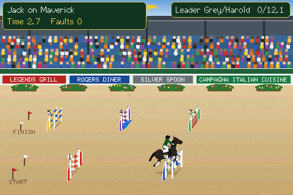

## Easiest: the web installer

### [➡ Open the Web Installer](https://grey-lancaster.github.io/Show-Jumping/)

Use **Chrome or Edge on a computer**, plug the board in by USB, pick your board in the list and click Connect, then Flash. No software to install. The files below are for updating a board that is already running, or for flashing by hand.

## Pick your board

| Build | Board | Display |
| --- | --- | --- |
| `cyd40` | **CYD 4.0" / Freenove ESP32 Display 4.0"** (ESP32-32E, "FNK0103S" docs) | ST7796 480×320, resistive touch, speaker, no PSRAM |
| `freenove4` | **Freenove 4.0"** (FNK0104S) | ESP32-S3, ST7796 480×320, capacitive touch |
| `freenove28` | **Freenove 2.8"** (FNK0104B/AB) | ESP32-S3, ILI9341 320×240, capacitive touch, speaker |
| `cyd28` | **CYD 2.8"** (ESP32-2432S028) | ILI9341 display (the standard one-USB board) |
| `cyd28usb2` | **CYD 2.8" with an ST7789 display** | the 2-USB variant (starts with red/blue swapped, as those panels need) |

Colours wrong on a CYD? You most likely picked the wrong CYD build; try the other one. The web page also has **Swap red/blue** and **Invert colours** switches. Nothing is damaged.

## Which file do I want?
| File | Use it to | WiFi and settings |
| --- | --- | --- |
| `Show-Jumping-<build>-factory.bin` | install on a new board, or recover one | **wiped** (you set up WiFi again on the screen) |
| `Show-Jumping-<build>-update.bin` | update a board that is already running Show Jumping | **kept** |

**Factory file:** flash it at offset 0, for example
`esptool.py --chip esp32 write_flash 0x0 Show-Jumping-cyd40-factory.bin` (use `--chip esp32s3` for the two Freenove builds; Freenove boards: hold BOOT, tap RESET, release BOOT first), then press RESET.

**Update file:** open the board's web page (CYD 4.0": `http://showjump40.local`; Freenove 4.0": `http://showjump.local`; Freenove 2.8": `http://showjump28.local`; CYD 2.8": `http://cydshowjump.local`), press **Firmware update**, choose the file for your board and let it upload; it restarts by itself. From a computer: `espota.py -i <ip> -p 3232 -f Show-Jumping-<build>-update.bin -r`. Only use a file whose name contains your own build name.
