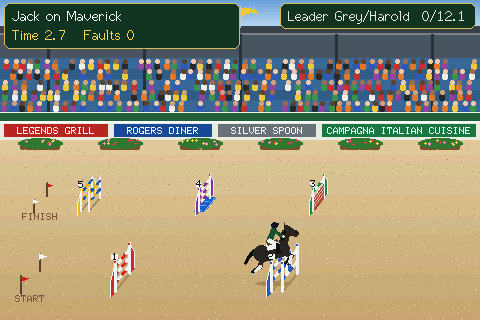
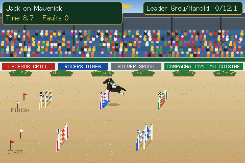
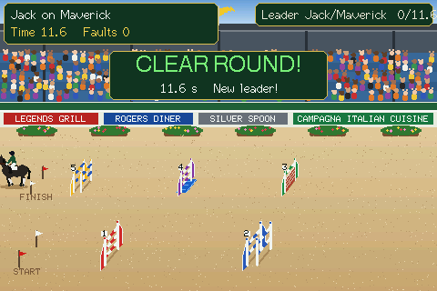
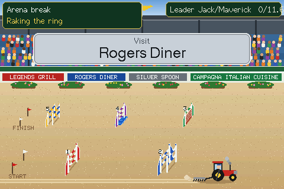
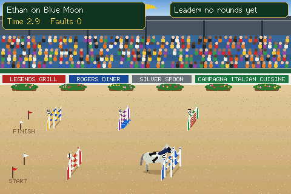
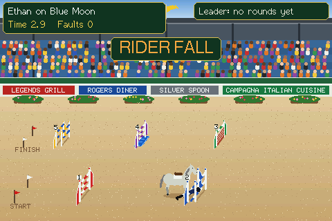
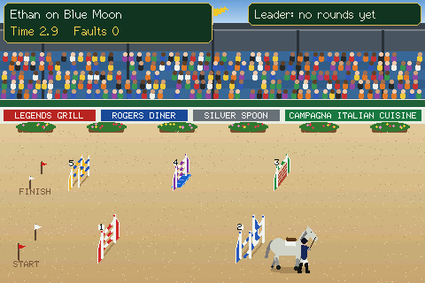

# Show Jumping

An animated show jumping arena for the same five boards as Deer Hunt: the **CYD 4.0"** (Freenove ESP32 Display 4.0"), the **Freenove 4.0"** and **2.8"** (ESP32-S3) and the **CYD 2.8"** (one or two USB ports). Built the same way as Deer Hunt and the Fish Tank: one 480x320 virtual world scaled to the panel, drawn procedurally into a full frame in PSRAM (Freenove) or in horizontal strips over a scenery cache kept in flash (the CYDs have no PSRAM).

## Easiest way: the web installer

### [➡ Open the Web Installer](https://grey-lancaster.github.io/Show-Jumping/)

Use **Chrome or Edge on a computer**, plug the board in by USB, pick your board in the list, click **Connect**, then **Flash**. (Freenove boards: hold BOOT, tap RESET, release BOOT first, and press RESET after flashing.) On a CYD the first start asks you to calibrate the touch screen (five crosshairs); then every board asks you to pick your WiFi on the screen.

Prefer to download files? The [latest release](../../releases/latest) has a factory file (a new board) and an update file (a board that is already running; keeps WiFi and settings).

## Screenshots
Straight from the board (`/api/frame`, the web page's *Screenshot* button).

| | |
|---|---|
|  |  |
| Over the water at fence 4 | Clear round: the crowd jumps up and down |
|  |  |
| Every 5 rounds the tractor rakes the ring, with a sponsor board over the stands | A fall: the horse digs in and the rider goes over his head |
|  |  |
| Down at the foot of the fence, the rail with him | Leading the horse out along the edge of the ring |

## What it does
- **The course:** a horse and rider canter round **five fences** in front of a packed grandstand: the near line left to right (a vertical and an oxer), a U-turn at the right end of the ring, then the far line right to left (a wall, a vertical with a **water tray** under it, and an oxer).
- **Ten riders and horses** take turns (bay, chestnut, grey and black coats), each horse with its own pace, so round times differ.
- **Scoring:** every round is timed. A knocked rail falls to the sand and costs **4 faults**. At the finish a banner over the stands shows *Clear round!* or the faults, with the time and the place the round took (*2nd place*, *1st, new leader!*), and the leader is shown top-right (the web page keeps a top-10 leaderboard).
- **Refusals:** now and then a horse props to a stop in front of a fence, the rider turns him away, loops back round and tries again (4 faults; the *Refusal +4* box comes up 1.5 s after he stops). About 1 auto round in 10 has one refusal, and 1 in 20 refuses twice at the same fence and is **eliminated** (an "ooooh" from the crowd, then applause as he walks out by the edge track) (`REFUSE_ONE`, `REFUSE_TWO` in `src/main.cpp`).
- **Falls:** every 9 rounds (`FALL_EVERY`) the horse digs in at a random fence and the rider goes over his head, bringing the top rail down. The crowd goes "ooooh"; he gets up, gathers the reins and leads the horse out of the ring on foot to applause by the clear track at the edge (no fences in the way). Eliminated.
- **The crowd** claps at the end of every round, and after a clear round the whole stand **jumps up and down**.
- **Tap the screen to ride yourself.** A tap between rounds makes the next round yours; during a round every tap makes the horse take off right there, so time it before each fence (too early or too late and the rail comes down). Miss a take-off and he refuses; a second refusal is elimination.
- **Raking the ring:** every 5 rounds (`TRACTOR_EVERY`) a little red tractor drags a rake round the ring, leaving combed stripes in the sand. The web page has a *Rake the ring* button to send it out after the current round.
- **Sponsors:** boards round the ring for Legends Grill, Rogers Diner, Silver Spoon and Campagna Italian Cuisine. While the tractor is out a sponsor board goes up over the stands, taking turns: *Visit Legends Grill*, *Visit Rogers Diner*, *Visit the Silver Spoon*, *Visit Campagna Italian Cuisine*.
- **Sounds,** all synthesised: canter hoofbeats, the start bell, knocked poles, applause, the tractor putt-putting.
- **Names:** the web page has a *Riders and horses* list where all ten rider and horse names can be changed (kept after a restart).
- **WiFi is set up on the screen** with [TouchWifiProvisioner](https://github.com/Grey-Lancaster/TouchWifiProvisioner) (BOOT skips it). Web page at `http://showjump40.local` (Freenove 4.0": `showjump.local`, Freenove 2.8": `showjump28.local`, CYD 2.8": `cydshowjump.local`): leaderboard, next rider, sound and volume, flip screen, swap red/blue, invert colours, screenshot, recalibrate touch, hostname, forget WiFi, restart.
- **Firmware update page** at `/update` ([ElegantOTA](https://github.com/ayushsharma82/ElegantOTA)) and ArduinoOTA. BOOT shows the connection info.

## Builds
| Env | Board |
|---|---|
| `cyd40` (default) | CYD 4.0" / Freenove ESP32 Display 4.0" (ESP32-32E, "FNK0103S" docs), ST7796 480x320, resistive touch, no PSRAM |
| `freenove4` | Freenove FNK0104S 4.0", ST7796 480x320, ESP32-S3 N16R8 |
| `freenove28` | Freenove FNK0104B/AB 2.8", ILI9341 320x240, ESP32-S3 |
| `cyd28` | CYD 2.8", ILI9341, one USB port |
| `cyd28usb2` | CYD 2.8", ST7789, two USB ports |

`pio run -e <env>`. Only the CYD 4.0" has been run on a real board so far; the other four builds come from Deer Hunt's board settings. Wrong colours on a CYD almost always means the wrong env (driver); there are also swap red/blue and invert switches on the web page. Pushing a tag like `v1.5.2` makes CI build all five, publish a release with a factory and an update file for each, and refresh the web installer in `docs/` (GitHub Pages serves `docs/` from `main`).

## Layout
- `src/main.cpp` - arena, course, horse and rider, rounds, scoreboard, web page.
- `src/audio.cpp` - the synthesised sounds.
- `src/board.h`, `src/hal_cyd28.cpp` (CYDs), `src/hal_freenove.cpp` + `src/es8311.*` + `lib_freenove/` (Freenove), `src/wifi_setup.cpp`, `src/canvas.h` - the board layer from Deer Hunt.
- `docs/` - the web installer. `.github/` - CI, release notes and the installer refresh.
